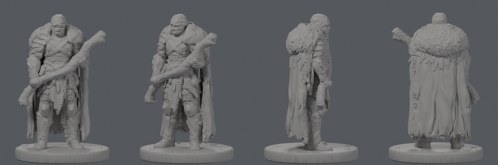

# Zabandażowany druid: figurka D&D do druku

Figurka do druku żywicznego (MSLA) w skali 32 mm heroic: postać 1,90 m, czyli **36 mm od stopy do czubka głowy**. Zintegrowana okrągła podstawka **25 × 3 mm** (rozmiar Medium), wysokość całkowita ok. 39 mm, ok. 4,2 ml żywicy.

## Pliki do druku (`print/`)
| Plik | Opis |
|---|---|
| **`druid_mini_v5.3mf`** / `druid_mini_v5_stl.zip` | **aktualna wersja**, szczelna, jednolita bryła, 1,9 mln trójkątów |
| `druid_mini_v4.3mf` / `_stl.zip` | poprzednia wersja (3MF po naprawie eksportu) |
| `druid_mini_v3.3mf` / `_stl.zip` | pierwsza wersja z CPU-Hunyuan |
| `druid_mini_36mm.3mf` / `_stl.zip` | v2 (historyczna) |

**Druk:** otwórz 3MF w Lychee albo Chitubox, pochyl model o 35–45° tyłem do stołu, dodaj podpory automatyczne (średnie pod konarem), warstwa 0,03–0,05 mm. Najdelikatniejsze miejsca to poszarpane brzegi peleryny i końcówki futra.

## Historia wersji
- **v1**: w pełni proceduralna w Blenderze (`scripts/procedural/`), porzucona („ludzik Lego”).
- **v2**: FLUX Kontext (prosty konar), Hunyuan3D-2.1 (Space), proceduralny konar i relief 0,1 mm. Za słaba.
- **v3–v5**: plan z `PLAN.md`:
  - Kontext: edycja frontu i spójne widoki,
  - Hunyuan3D-2 mini/mv **na CPU**,
  - bryła hybrydowa,
  - pass detalu: skrzyżowane bandaże na głowie, kosmyki futra, fałdy i poszarpana peleryna, usuwanie cienkich wypustek,
  - walidacja.

  Szczegóły prób: `v3/LOG.md`, a proces: `v3/PIPELINE.md`.

## Struktura
- `concept/`: oryginalne grafiki i zdjęcie referencyjne konaru
- `prepped/`, `edit/`: przygotowane i edytowane widoki
- `ai/`: surowe siatki z modeli AI
- `v3/scripts/`: aktualny pipeline (hy_cpu, views, normals, hybrid, detail, depeg, finalize, thick3, render)
- `scripts/`: wcześniejsze skrypty (v1/v2, Space'y HF)
- `renders/`: rendery i porównania wersji
- `HANDOFF.md`, `PLAN.md`: kontekst i plan
